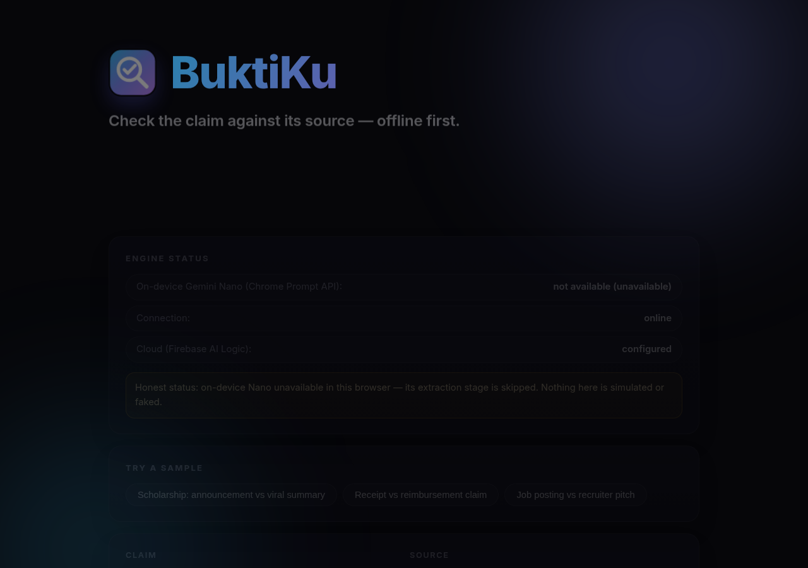
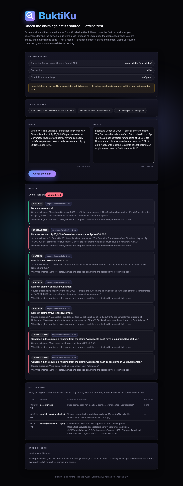

<p align="center">
  
</p>

# BuktiKu

**Check the claim against its source — offline first.**

**Live demo: <https://buktiku.onrender.com>**

BuktiKu is an offline-first claim checker, built for the
[Firebase #BuildHybridAI 2026](https://firebasehybridaihackathon.devpost.com/)
hackathon. You paste two texts:

- a **claim** — a viral summary, a recruiter's pitch, a reimbursement note; and
- its **source** — the original announcement, receipt, or posting.

BuktiKu checks the claim *against that source only*. There is no open-web
fact-checking and no invented "facts": the source you paste is the ground
truth.



## How hybrid routing works

Every check runs through three layers, and every routing decision is
written to a visible routing log in the UI. A fallback is stated, never
hidden.

1. **Deterministic engine (always, offline, instant).**
   Numbers, dates, names and dropped source conditions are extracted and
   compared by plain code (`public/lib/engine.js`). A number the claim
   changed, a deadline it moved, a condition it quietly dropped — code
   catches these, and code's verdict on numbers and dates always wins
   over any model's.

2. **On-device Gemini Nano (Chrome Prompt API).**
   When the browser exposes the `LanguageModel` API, Nano extracts the
   claim's checkable points locally. *Why on-device:* the texts — which
   may be sensitive documents — never leave the device for this stage;
   it costs no data and works with no signal. Extraction is a small
   task Nano handles well.

3. **Cloud Gemini via Firebase AI Logic.**
   When the browser is online, points the local layers mark
   `needs-cloud` — plus a full deep check — are escalated to Gemini
   (`gemini-3.8-flash`) through **Firebase AI Logic** (the Gemini API
   is never called directly; there is no standalone Gemini API key in
   this app), protected by **App Check**. *Why cloud:* semantic
   mismatches — a deadline rephrased, a requirement softened — need the
   bigger model. Cloud calls are bounded (45 s per attempt, at most 3
   attempts, and quota/auth errors are never retried), so a stalled or
   exhausted cloud degrades to the local verdict with the reason written
   in the routing log — it never hangs the check.

Each result row carries a **routing badge**: which engine produced the
verdict, why, and its latency in milliseconds. The overall verdict is
`Consistent`, `Partly off`, or `Contradicted`.



**Honest fallback labelling.** If Nano is unavailable in the browser, or
the cloud call fails, the UI says so in plain language and no AI verdict
is ever simulated or faked.

**A note on quota.** The demo runs on the Spark (free) plan, whose
Gemini quota is 20 cloud requests per day for the whole project. Local
and on-device checks are unlimited; once the day's cloud quota is gone,
checks keep working and the routing log says the deep check was
skipped — by design, not by accident.

## Saved checks (Firestore)

Every completed check is saved to **Cloud Firestore** under
`users/{uid}/checks`, where the uid comes from **Firebase Anonymous
Authentication** — no sign-up, no email. The security rules are the
whole privacy story:

```
rules_version = '2';
service cloud.firestore {
  match /databases/{database}/documents {
    match /users/{userId}/checks/{checkId} {
      allow read, write: if request.auth != null && request.auth.uid == userId;
    }
  }
}
```

Opening a saved check re-renders its stored verdict and points
**without re-running any engine** — it costs no Gemini quota and works
from the already-loaded page.

## Design

A dark, MotionSites-style interface: near-black canvas with slowly
drifting blue→purple glows, glass cards, pill controls, a flowing
gradient wordmark, scroll-reveal sections and staggered result rows.
All motion is CSS/IntersectionObserver, and `prefers-reduced-motion`
turns it off. The logo is a hand-built SVG (magnifier + check) in the
same gradient.

## Setup

### Run locally

```bash
npm start          # serves http://localhost:3000 (or $PORT)
npm test           # 17 tests: engine + Firestore document shape
```

No dependencies to install — the server is a dependency-free Node
static server, and the Firebase SDK is loaded from Google's CDN in the
browser.

The app ships wired to its real Firebase project (`buktiku-d5216`):
AI Logic enabled (Gemini Developer API backend, Spark plan), App Check
in debug-token mode for development (register the token printed in the
browser console under *App Check → Apps → Manage debug tokens*; a
reCAPTCHA v3 site key can be dropped into `public/firebase-config.js`
for production), Firestore created with the rules above, and Anonymous
Authentication enabled. To point it at your own project instead,
replace the values in `public/firebase-config.js` and repeat those
console steps; with a placeholder config the app still runs, with the
cloud and history layers honestly logged as skipped.

## Architecture

```
server.js                  dependency-free static server (npm start)
public/
  index.html               single-page UI (English)
  styles.css               dark theme + motion system
  logo.svg                 hand-built SVG logo (also the favicon)
  app.js                   UI wiring and rendering only
  firebase-config.js       Firebase project config (public identifiers)
  lib/
    engine.js              deterministic comparator (pure JS, unit-tested)
    samples.js             3 built-in claim/source pairs with planted errors
    nano.js                on-device path: Chrome Prompt API (LanguageModel)
    cloud.js               cloud path: Firebase AI Logic (firebase/ai) + App Check
    store.js               saved checks: Firestore + Anonymous Auth
    router.js              hybrid router + routing log
tests/
  engine.test.js           engine tests over all 3 sample pairs + controls
  store.test.js            Firestore document-shape tests
scripts/
  verify-cloud.cjs         live end-to-end proof of the cloud path
  verify-store.cjs         live end-to-end proof of save/reload/restore
```

The models propose; the engine decides. Nano and the cloud model extract
and explain — verdicts on numbers, dates and names are computed by
`engine.js`, which is why the sample pairs' planted mismatches (an
altered scholarship amount and a dropped GPA condition, an inflated
reimbursement total, an inflated salary and a moved deadline) are caught
even fully offline with no model at all.

## License

Apache-2.0 — see [LICENSE](LICENSE).
